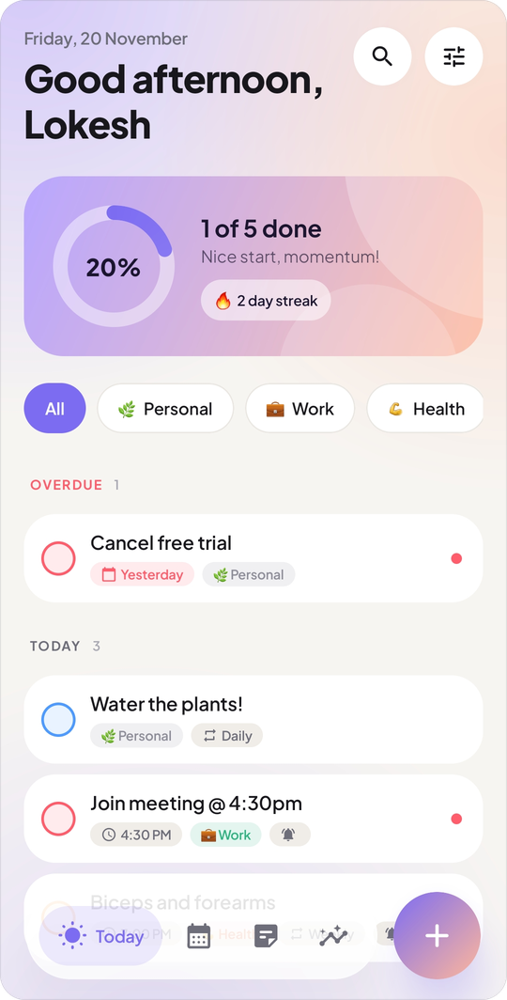
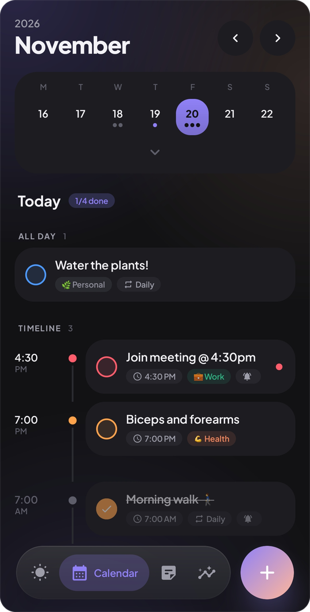
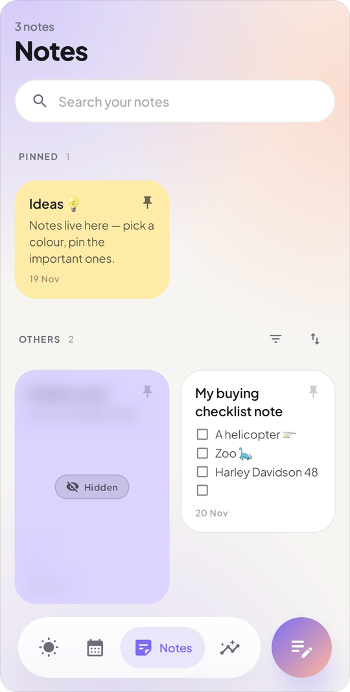
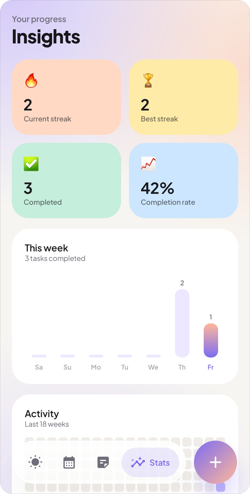
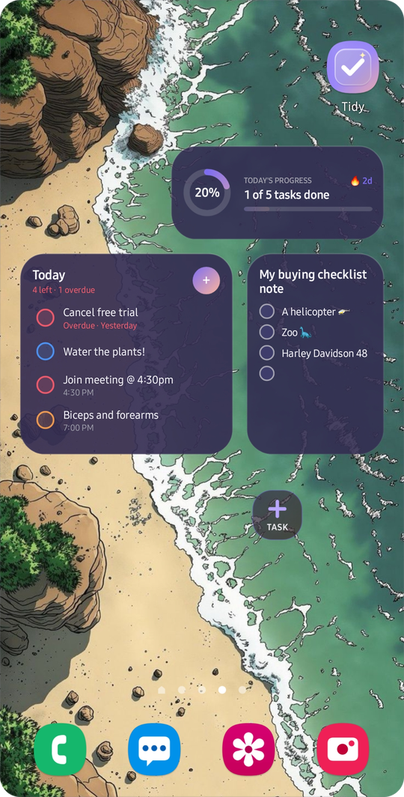
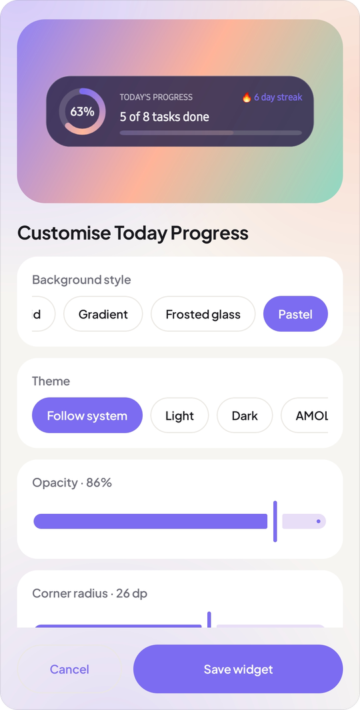
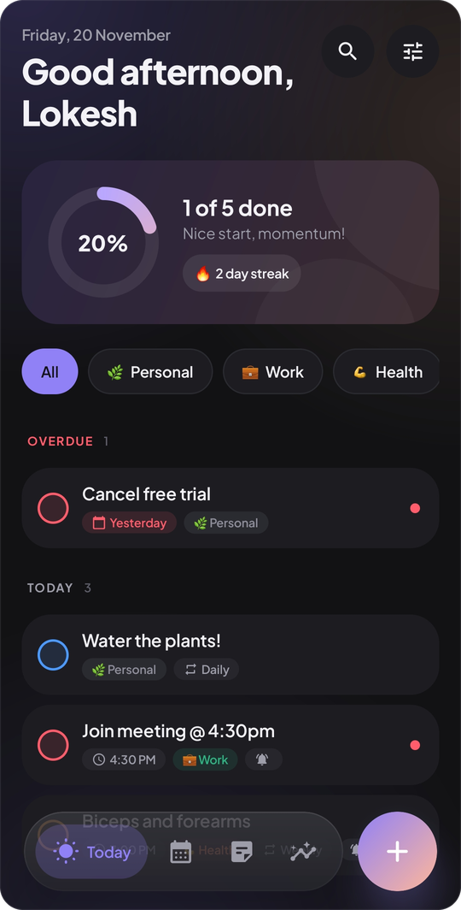
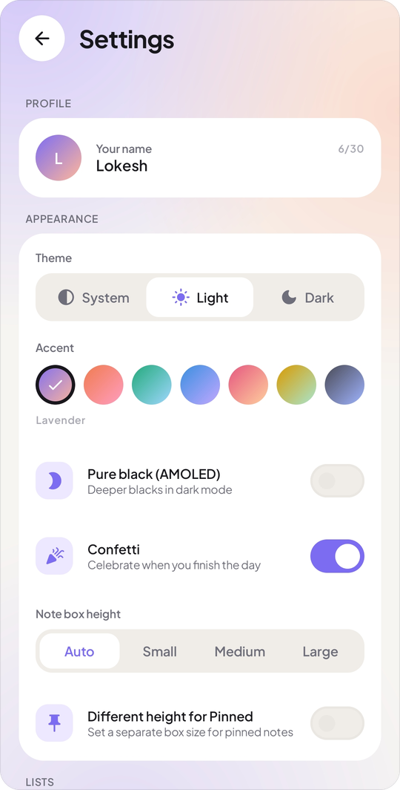
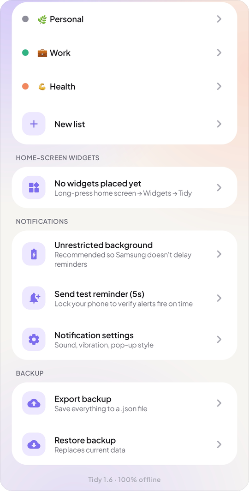
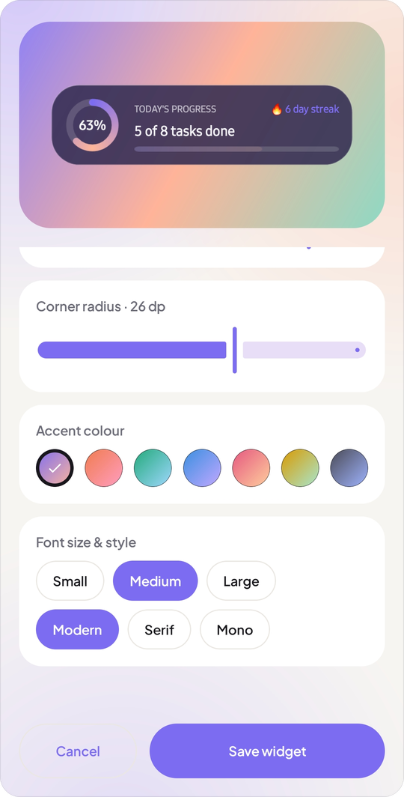

# Tidy — Minimal To-Dos, Notes & Widgets for Android

[](https://github.com/lokiT26/Tidy/releases/latest)
[](https://github.com/lokiT26/Tidy/releases)
[](https://github.com/lokiT26/Tidy/releases/latest)
[](https://github.com/lokiT26/Tidy/stargazers)
[](LICENSE)
-3DDC84?logo=android&logoColor=white)


**Tidy** is a fast, 100% offline Android To-Do and Notes app built with **Kotlin**, **Jetpack Compose**, **Room**, and **Jetpack Glance**. Zero ads, zero accounts, zero internet permission.

## Screenshots

<table>
  <tr>
    <td align="center" width="33%">
      <br />
      <sub><b>Today</b> — Progress ring, streaks &amp; sections</sub>
    </td>
    <td align="center" width="33%">
      <br />
      <sub><b>Calendar (Dark)</b> — Week/month &amp; timeline</sub>
    </td>
    <td align="center" width="33%">
      <br />
      <sub><b>Notes</b> — Masonry grid, checklists &amp; blur</sub>
    </td>
  </tr>
  <tr>
    <td align="center" width="33%">
      <br />
      <sub><b>Insights</b> — Streaks &amp; 18-week heatmap</sub>
    </td>
    <td align="center" width="33%">
      <br />
      <sub><b>Home Widgets</b> — Frosted live widgets</sub>
    </td>
    <td align="center" width="33%">
      <br />
      <sub><b>Widget Customiser</b> — Live style editor</sub>
    </td>
  </tr>
</table>

<details>
<summary>More screenshots (Dark Mode, Settings, Backup &amp; Widget Controls)</summary>
<br />
<table>
  <tr>
    <td align="center" width="25%">
      <br />
      <sub><b>Today (Dark)</b></sub>
    </td>
    <td align="center" width="25%">
      <br />
      <sub><b>Themes &amp; Accents</b></sub>
    </td>
    <td align="center" width="25%">
      <br />
      <sub><b>Offline Backup</b></sub>
    </td>
    <td align="center" width="25%">
      <br />
      <sub><b>Fonts &amp; Colours</b></sub>
    </td>
  </tr>
</table>
</details>

## Download

Grab the latest signed APK from [**GitHub Releases**](https://github.com/lokiT26/Tidy/releases/latest) (supports in-place upgrades and [Obtainium](https://apps.obtainium.imranr.dev/redirect?r=obtainium://add/https://github.com/lokiT26/Tidy)).

## Features

- **Today** — Greeting header, progress ring & streak card, category filter chips, swipe right to complete/reopen, 2-step swipe left to delete with 8-second swipeable Undo, long-press drag-to-reorder within sections & dates, expandable subtasks, and light/dark-adaptive confetti.
- **Task Editor** — Due dates & times, exact reminders (plus custom offsets), recurring schedules (`Daily`, `Weekdays`, `Weekly`, `Monthly`, `Yearly`), priorities, custom lists, and inline editable subtasks.
- **Calendar** — Expandable week/month grid with horizontal swipe navigation and vertical timeline.
- **Notes** — Google Keep-style staggered masonry grid, pinned notes, pastel colours, checklists with multi-line item support, per-section box height presets (`Auto`, `Small`, `Medium`, `Large`), colour & type filtering, sorting, and real Gaussian blur to hide sensitive notes.
- **Insights** — Streaks, weekly completion chart, 18-week activity heatmap, and per-list progress.
- **5 Customisable Home-Screen Widgets** — To-Do List, responsive Today Progress (`3×1`, `2×1`, `1×1`), Sticky Note (with interactive checklists), interactive Week + Tasks, and 1×1 Quick Add — each with live-preview customisation over your real home-screen wallpaper for background style, opacity, corner radius, theme (System/Light/Dark/AMOLED), accent palette, font size & style, and density.
- **Offline AI Plan Import & Share-to-Tidy** — Copy a ready-made adaptive prompt from Tidy into any AI (ChatGPT, Gemini, Claude), then paste, share, or import the response to batch-add scheduled tasks, reminders, subtasks, and checklist notes with preview & 1-tap Undo — while keeping zero internet permission.
- **Private & Offline** — Zero internet permission, no account, and full JSON Export / Restore backups.

## Building from Source

```bash
./gradlew testDebugUnitTest assembleRelease
```

To sign release builds with your own key, create a local `keystore.properties` (never commit it):

```properties
storeFile=tidy-release.jks
storePassword=your-store-password
keyAlias=tidy
keyPassword=your-key-password
```

Without `keystore.properties`, `assembleRelease` falls back to the local Android debug keystore.

---

> ⭐ **Enjoying Tidy?** If it helps keep your day a little calmer, consider starring the repo — it helps others discover it!
